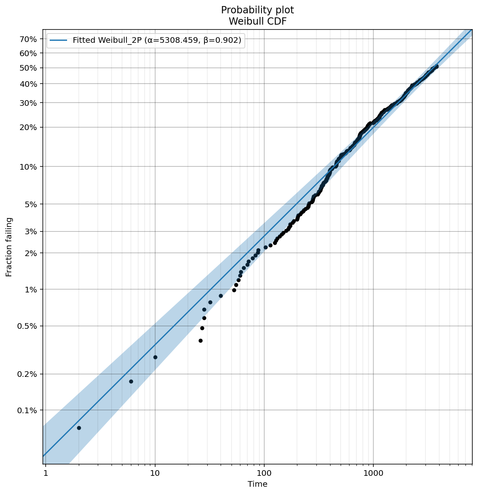

# Turnout lifetime analysis with a Weibull distribution

Railway turnouts are repairable assets. This example analyses **time to first failure (TTFF)**. It treats each turnout as a non-repairable unit for this analysis and includes all turnouts in the selected BIS cohort, even those without a recorded failure.

Each turnout contributes one observation:
- If a failure is recorded during the analysis period, the observation is the time from installation to the first recorded failure.
- If no failure is recorded by the end of the analysis period, the lifetime is treated as right-censored at the end of that period.

The example uses the `reliability` Python package. It treats January 1 of the installation year as the installation date because the source data only contains the year.

## Connect to the database

Load the connection settings and create a PostgreSQL engine:

```python
from sqlalchemy import URL, create_engine
from dotenv import load_dotenv
import os

load_dotenv()

username = os.environ.get('STUDENT_USER')
password = os.environ.get('STUDENT_PASSWORD')
host = os.environ.get('SQL_ENDPOINT')
dbname = os.environ.get('SQL_DBNAME')
port = 5432

connection_url = URL.create(
    "postgresql+psycopg2",
    username=username,
    password=password,
    host=host,
    port=port,
    database=dbname,
)

engine = create_engine(connection_url)
```

## Set the analysis period

The data include installations from 1 January 2010 through 31 December 2020. 

```python
import pandas as pd

analysis_start = pd.to_datetime('2010-01-01')
analysis_end = pd.to_datetime('2021-01-01')
```

This could also be retrived from the database as
```python
analysis_start = pd.read_sql("""
SELECT MIN("Anmält datum")
FROM ofeliadata
""", engine).iloc[0,0]

analysis_end = pd.read_sql("""
SELECT MAX("Anmält datum")
FROM ofeliadata
""", engine).iloc[0,0]

analysis_start = pd.to_datetime(analysis_start)
analysis_end = pd.to_datetime(analysis_end)
```

## Find the first matching Ofelia report

The query keeps BIS turnouts with point machine model `Mdl1` and track (`Hsp`) category `nhsp` or `ahsp`, e.g. main track. The `LEFT JOIN` keeps each matching turnout even when it has no matching Ofelia report. The join limits reports to the selected asset part (`Omläggningsanordning`) and to reports on or after the estimated installation date. `MIN` returns the earliest matching report.

The join ignores reports before 1 January of the installation year. Since only the year is known, a report earlier than the actual installation day but later in that same year cannot be distinguished.

```python
data = pd.read_sql("""
SELECT
    b."Bdl",
    b."Pl_Forb",
    b."Växelnr",
    b."Inläggningsår Växel",
    MIN(o."Anmält datum") AS first_failure
FROM bisdata b
LEFT JOIN ofeliadata o
    ON b."Pl_Forb" = o."Pl_Forb"
   AND b."Växelnr" = o."Anläggningsindivid"
   AND o."Anläggningsdel (BVS)" = 'Omläggningsanordning'
   AND o."Anmält datum" >=
       make_date(b."Inläggningsår Växel"::integer, 1, 1)
WHERE b."Hsp" IN ('nhsp', 'ahsp')
  AND b."Växeldriv modell" = 'Mdl1'
GROUP BY
    b."Bdl",
    b."Pl_Forb",
    b."Växelnr",
    b."Inläggningsår Växel";
""", engine)

data["first_failure"] = pd.to_datetime(data["first_failure"])
```

## Select installations within the study period

Convert the installation year to an estimated date. Rows with missing or invalid years become `NaT` and are excluded by the period filter.

```python
year = pd.to_numeric(data["Inläggningsår Växel"], errors="coerce")
installation_date = pd.to_datetime(
    year.astype("Int64").astype("string") + "-01-01",
    errors="coerce"
)

valid = (
    (installation_date >= analysis_start)
    & (installation_date < analysis_end)
)
```

This cohort includes turnouts installed during the study period. It avoids including turnouts that were already in service before observation began.

## Calculate failure and censored times

Reports on or after `analysis_end` are outside the study window. A turnout with no matching report during the window is right-censored at `analysis_end`.

```python
data.loc[data["first_failure"] >= analysis_end, "first_failure"] = pd.NaT
failed = data["first_failure"].notna()

failures = (
    data.loc[valid & failed, "first_failure"]
    .sub(installation_date[valid & failed])
    .dt.days
)

right_censored = (
    analysis_end
    - installation_date[valid & ~failed]
).dt.days

```

Both sets of times are measured in days from the estimated installation date. `failures` contains observed first failures; `right_censored` contains follow-up times for turnouts without a matching failure before the study ended.

## Fit the Weibull distribution

The `reliability` package is an extra dependency for this analysis. Install it with `python -m pip install reliability`. The two-parameter Weibull fit uses observed failure times and right-censored times. It needs at least two positive failure times when `force_beta` is not specified.

```python
from reliability.Fitters import Fit_Weibull_2P

results = Fit_Weibull_2P(
    failures=failures.values,
    right_censored=right_censored.values,
    show_probability_plot=True
)
```

The result estimates a Weibull distribution for the selected cohort and failure definition. It describes time to the first matching report.

The analysis plot is available as `Probability_plot_Weibull_CDF.png`:


