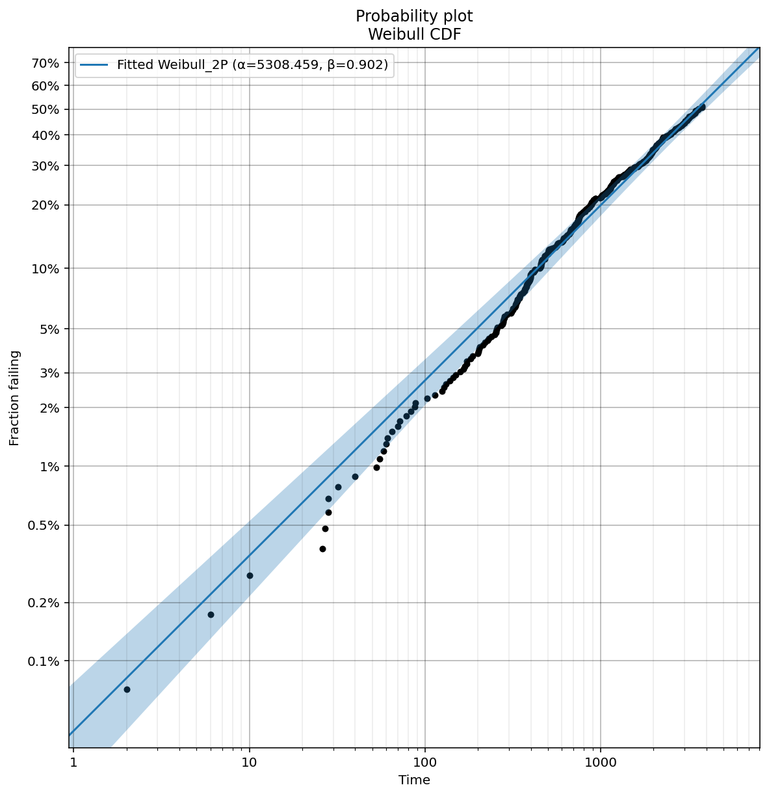

# Livslängdsanalys av växlar med Weibullfördelning

Järnvägsväxlar är reparerbara tillgångar. Det här exemplet analyserar **tid till första fel (TTFF)**. I analysen behandlas varje växel som en icke-reparerbar enhet. Alla växlar i den valda BIS-kohorten ingår, även de som saknar registrerade fel.

Varje växel bidrar med en observation:

- Om ett fel registreras under analysperioden är observationen tiden från installation till det första registrerade felet.
- Om inget fel registreras innan analysperioden slutar högercensureras livslängden vid periodens slut.

Exemplet använder Python-paketet `reliability`. Eftersom källdatan bara innehåller installationsåret används den 1 januari det året som installationsdatum.

## Anslut till databasen

Läs in anslutningsuppgifterna och skapa en PostgreSQL-motor:

```python
from sqlalchemy import URL, create_engine
from dotenv import load_dotenv
import os

load_dotenv()

username = os.environ.get('STUDENT_USER')
password = os.environ.get('STUDENT_PASSWORD')
host = os.environ.get('SQL_ENDPOINT')
dbname = os.environ.get('SQL_DBNAME')
port = 5432

connection_url = URL.create(
    "postgresql+psycopg2",
    username=username,
    password=password,
    host=host,
    port=port,
    database=dbname,
)

engine = create_engine(connection_url)
```

## Ange analysperioden

Analysperioden omfattar installationer från den 1 januari 2010 till och med den 31 december 2020.

```python
import pandas as pd

analysis_start = pd.to_datetime('2010-01-01')
analysis_end = pd.to_datetime('2021-01-01')
```

Datumen kan också hämtas från databasen:

```python
analysis_start = pd.read_sql("""
SELECT MIN("Anmält datum")
FROM ofeliadata
""", engine).iloc[0,0]

analysis_end = pd.read_sql("""
SELECT MAX("Anmält datum")
FROM ofeliadata
""", engine).iloc[0,0]

analysis_start = pd.to_datetime(analysis_start)
analysis_end = pd.to_datetime(analysis_end)
```

## Hitta den första matchande Ofelia-rapporten

Frågan väljer BIS-växlar med växeldrivsmodell `Mdl1` och spårkategori (`Hsp`) `nhsp` eller `ahsp`, till exempel huvudspår. `LEFT JOIN` behåller varje växel som matchar BIS-villkoren, även om den saknar en matchande Ofelia-rapport. Kopplingen begränsar rapporterna till den valda anläggningsdelen (`Omläggningsanordning`) och till rapporter från och med det uppskattade installationsdatumet. `MIN` returnerar den tidigaste matchande rapporten.

Kopplingen bortser från rapporter före den 1 januari under installationsåret. Eftersom endast året är känt går det inte att avgöra om en rapport från samma år inträffade före eller efter den faktiska installationsdagen.

```python
data = pd.read_sql("""
SELECT
    b."Bdl",
    b."Pl_Forb",
    b."Växelnr",
    b."Inläggningsår Växel",
    MIN(o."Anmält datum") AS first_failure
FROM bisdata b
LEFT JOIN ofeliadata o
    ON b."Pl_Forb" = o."Pl_Forb"
   AND b."Växelnr" = o."Anläggningsindivid"
   AND o."Anläggningsdel (BVS)" = 'Omläggningsanordning'
   AND o."Anmält datum" >=
       make_date(b."Inläggningsår Växel"::integer, 1, 1)
WHERE b."Hsp" IN ('nhsp', 'ahsp')
  AND b."Växeldriv modell" = 'Mdl1'
GROUP BY
    b."Bdl",
    b."Pl_Forb",
    b."Växelnr",
    b."Inläggningsår Växel";
""", engine)

data["first_failure"] = pd.to_datetime(data["first_failure"])
```

## Välj installationer inom analysperioden

Gör om installationsåret till ett uppskattat datum. Rader med saknade eller ogiltiga år blir `NaT` och tas inte med av periodfiltret.

```python
year = pd.to_numeric(data["Inläggningsår Växel"], errors="coerce")
installation_date = pd.to_datetime(
    year.astype("Int64").astype("string") + "-01-01",
    errors="coerce"
)

valid = (
    (installation_date >= analysis_start)
    & (installation_date < analysis_end)
)
```

Kohorten omfattar växlar som installerats under analysperioden. Växlar som redan var i drift när observationerna började ingår inte.

## Beräkna felfall och censurerade tider

Rapporter på eller efter `analysis_end` ligger utanför analysperioden. En växel utan matchande rapport under perioden högercensureras vid `analysis_end`.

```python
data.loc[data["first_failure"] >= analysis_end, "first_failure"] = pd.NaT
failed = data["first_failure"].notna()

failures = (
    data.loc[valid & failed, "first_failure"]
    .sub(installation_date[valid & failed])
    .dt.days
)

right_censored = (
    analysis_end
    - installation_date[valid & ~failed]
).dt.days
```

Båda tidsserierna mäts i dagar från det uppskattade installationsdatumet. `failures` innehåller observerade första fel. `right_censored` innehåller uppföljningstiden för växlar utan matchande fel före analysperiodens slut.

## Anpassa Weibullfördelningen

Paketet `reliability` är ett extra beroende för den här analysen. Installera det med `python -m pip install reliability`. Anpassningen med två Weibullparametrar använder observerade felfall och högercensurerade tider. Den behöver minst två positiva felfall när `force_beta` inte anges.

```python
from reliability.Fitters import Fit_Weibull_2P

results = Fit_Weibull_2P(
    failures=failures.values,
    right_censored=right_censored.values,
    show_probability_plot=True
)
```

Resultatet skattar en Weibullfördelning för den valda kohorten och feldefinitionen. Analysen beskriver tiden till den första matchande rapporten.

Analysdiagrammet finns i `Probability_plot_Weibull_CDF.png`:


